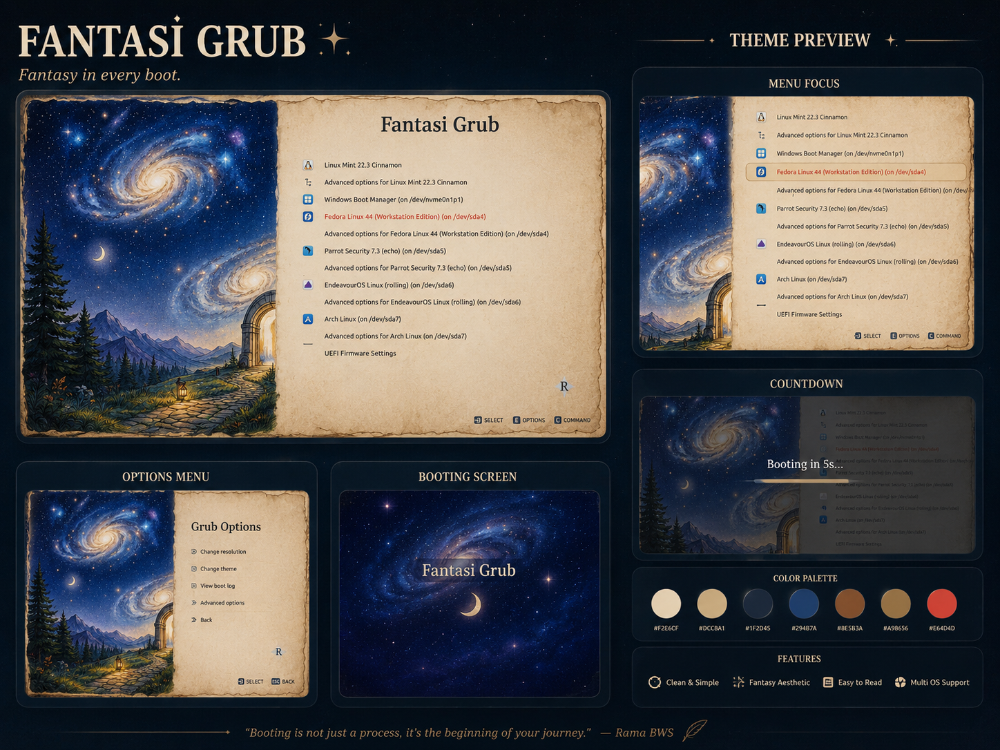

# 🌌 Fantasi GRUB Theme

> A custom GRUB bootloader theme inspired by fantasy literature, aged parchment, and deep space aesthetics.



## 📖 Overview

Fantasi GRUB Theme transforms the standard system boot menu into an immersive, fantasy-inspired interface. It blends warm parchment design elements with a dark celestial background, giving Linux a distinct and refined look right from system startup.

Built as an open-source project to explore GRUB’s layout engine, custom typography, and visual UI constraints.

---

## ⚡ Features

* **Fantasy-Inspired Aesthetics**: Parchment-style menu elements over a dark galaxy backdrop.
* **Clean UI Layout**: Optimized font spacing and selection highlights for high readability.
* **Automated Installation**: Simple shell script for quick installation and setup.

---

## 📦 Installation

### Quick Install (Recommended)

1. Clone the repository:
   ```bash
   git clone [https://github.com/Mora-project-ui/fantasi-grub-theme.git](https://github.com/Mora-project-ui/fantasi-grub-theme.git)
   cd fantasi-grub-theme
